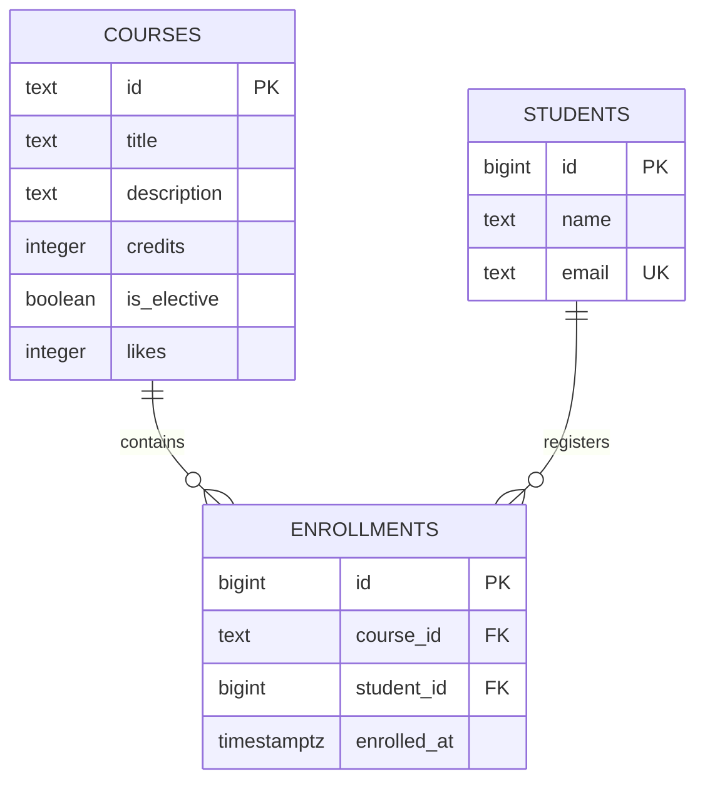

# Course Catalog Database

**Advanced Web Technologies — Lab 6**

## 1. Database Schema

The database contains three tables:

- `courses` — course information.
- `students` — student information.
- `enrollments` — student-course relationships.

### ER Diagram



## 2. How to Run

Database: `course-catalog-db`

Role: `catalog_app`

Run the SQL files in this order:

```bash
psql -U catalog_app -d "course-catalog-db" -f schema.sql
psql -U catalog_app -d "course-catalog-db" -f seed.sql
psql -U catalog_app -d "course-catalog-db" -f queries.sql
```

Expected initial data:

| Table | Rows |
|---|---:|
| courses | 6 |
| students | 3 |
| enrollments | 6 |

**Note:** `schema.sql` drops and recreates the tables. Running it again removes existing data, so execute `seed.sql` afterwards.

## 3. Constraint Violation Log

| # | Experiment | SQLSTATE | Constraint | API response |
|---:|---|---|---|---|
| 1 | NULL course title | `23502` | NOT NULL (`title`) | 422 |
| 2 | Zero credits | `23514` | `courses_credits_check` | 422 |
| 3 | Negative likes | `23514` | `courses_likes_check` | 500 |
| 4 | Short student name | `23514` | `students_name_check` | 422 |
| 5 | Duplicate email | `23505` | `students_email_key` | 409 |
| 6 | Duplicate course ID | `23505` | `courses_pkey` | 409 |
| 7 | Duplicate enrollment | `23505` | `enrollments_course_id_student_id_key` | 409 |
| 8 | Nonexistent course | `23503` | `enrollments_course_id_fkey` | 404 |
| 9 | Nonexistent student | `23503` | `enrollments_student_id_fkey` | 404 |
| 10 | Delete course with enrollments | `23001` | `enrollments_course_id_fkey` | 409 |

*PostgreSQL 18 returns `23001` for the RESTRICT violation. Earlier versions may return `23503`.*

### Pydantic Validation

Pydantic validates incoming data before it reaches PostgreSQL. It catches missing fields, invalid types, and invalid values. Database constraints provide additional protection and ensure data integrity. Validation errors should normally return HTTP 422.

### Cascading Delete

Deleting student `daniyar@example.com` removed their three enrollments:

- Before DELETE: 6 enrollments.
- After DELETE: 3 enrollments.
- After ROLLBACK: 6 enrollments.

This confirms that ON DELETE CASCADE works correctly.

## 4. Index Experiment

The experiment was performed in `idx_demo` with 500 courses, 20,000 students, and 50,000 enrollments.

Query:

```sql
SELECT *
FROM enrollments
WHERE student_id = 777;
```

### Execution Plans

**Before index:** PostgreSQL used `Seq Scan` and checked the whole table.

**After index:** PostgreSQL used `Bitmap Heap Scan` and `Bitmap Index Scan`.

Index creation:

```sql
CREATE INDEX enrollments_student_id_idx
ON enrollments (student_id);
```

### Execution Time

| Run | Before index | After index |
|---:|---:|---:|
| 1 | 2.639 ms | 0.136 ms |
| 2 | 3.362 ms | 0.042 ms |
| 3 | 2.699 ms | 0.053 ms |

### Index Size

| Object | Size |
|---|---:|
| enrollments table | 3336 kB |
| student_id index | 896 kB |

### Questions

**1. Why doesn't PostgreSQL automatically create an index on `student_id`?**

PostgreSQL automatically creates indexes for primary keys and UNIQUE constraints, but not for foreign keys. The existing composite UNIQUE index starts with `course_id`, so it is not suitable for lookups by `student_id` alone.

**2. Why does a lookup in `courses` use Seq Scan, while `enrollments` uses an index?**

The `courses` table contains only six rows, so scanning the entire table can be cheaper. The `enrollments` table contains 50,000 rows, making index lookup more efficient.

**3. Which operations benefit from the index?**

- Finding all enrollments belonging to a particular student.
- Deleting a student with ON DELETE CASCADE, because PostgreSQL must find the related enrollments.

## 5. Transaction Experiment

### Failed Transaction

A student was inserted, followed by an enrollment referencing a nonexistent course. The second INSERT failed because of a foreign-key violation.

After ROLLBACK, the student was also removed. The verification query returned `0` rows for that email.

### Successful Transaction

A student and an enrollment in `Web Security Essentials` were inserted in one transaction. Both operations succeeded and were saved with COMMIT.

### Two-Connection Experiment

Two Query Tool windows were used to observe transaction visibility.

| Stage | Second connection |
|---|---:|
| Before COMMIT | 0 rows |
| After COMMIT | 1 row |

Uncommitted changes were invisible to the second connection. After COMMIT, the new student became visible.

## 6. Design Decisions

**1. Why use three separate tables?**

Separating courses, students, and enrollments avoids unnecessary data duplication. The enrollments table represents the many-to-many relationship.

**2. Why use RESTRICT and CASCADE?**

RESTRICT prevents deleting a course that still has enrollments. CASCADE automatically removes a student's enrollments when that student is deleted.

**3. Why use database constraints?**

Constraints protect data integrity independently of application logic. They prevent invalid values, duplicate records, and references to nonexistent entities.

## 7. Acceptance Checklist

- [x] Three tables created with required columns and constraints.
- [x] Primary keys, foreign keys, CHECK, UNIQUE, NOT NULL, and DEFAULT implemented.
- [x] ON DELETE RESTRICT and CASCADE tested.
- [x] Initial data inserted: 6 courses, 3 students, 6 enrollments.
- [x] SQL queries implemented and tested.
- [x] Ten constraint violation experiments completed.
- [x] Cascading delete tested.
- [x] Pydantic validation question answered.
- [x] Index experiment completed with EXPLAIN plans and execution times.
- [x] Index added to `schema.sql`.
- [x] Transaction experiments completed.
- [x] ER diagram and Design Decisions included.

## 8. Repository

[GitHub — course-catalog-db](https://github.com/virtuer369/course-catalog-db)